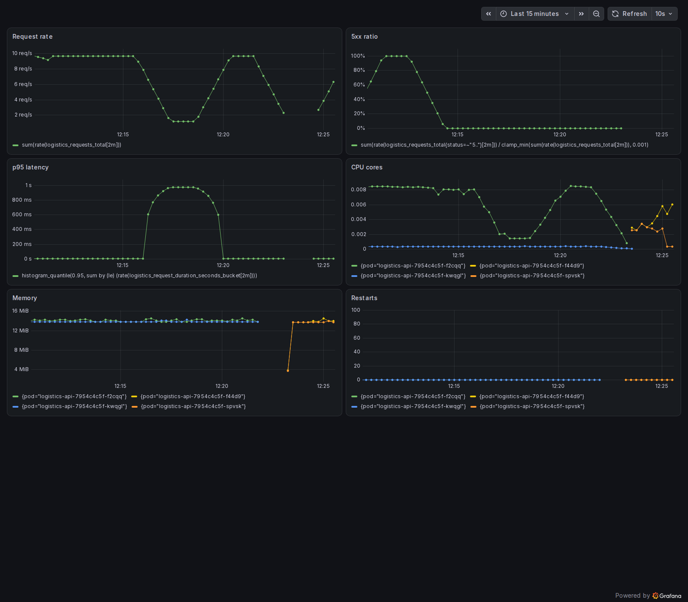
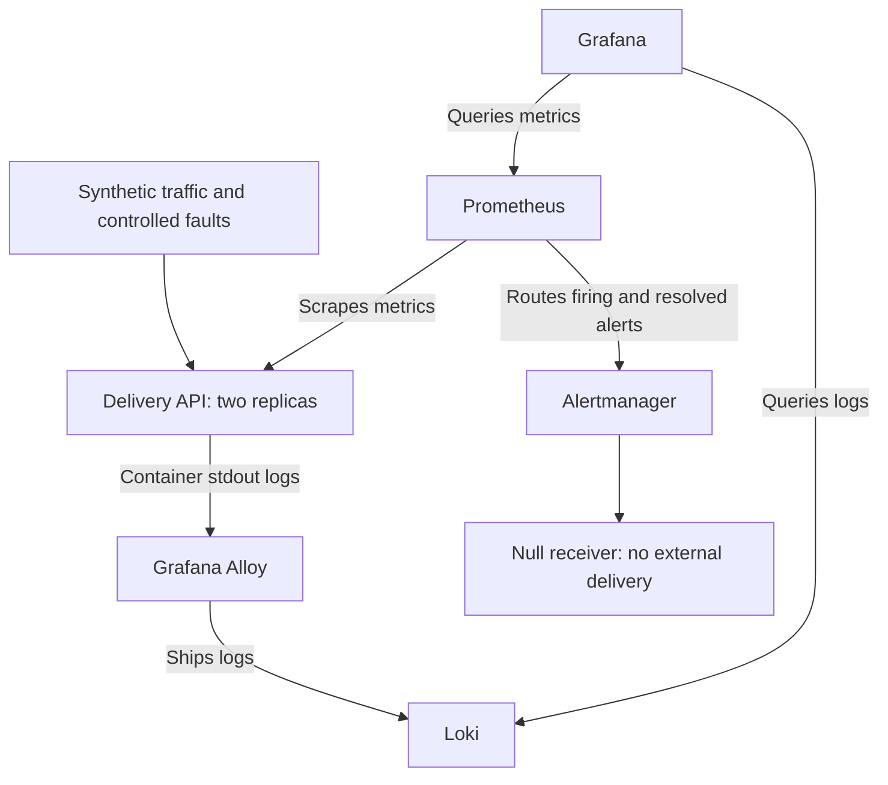

# Real-Time Logistics Observability and Alerting

[](https://github.com/niks6996/logistics-observability/actions/workflows/observability.yml)

A Kubernetes observability lab for a synthetic delivery-tracking API. It demonstrates
metrics collection, centralised logging, dashboards, and controlled incident detection
and recovery. This independent portfolio implementation uses no company code or customer data.

## Demonstrated behaviour

The saved deployment evidence shows a healthy kind cluster, metrics in Prometheus,
application logs in Loki, and firing/resolved states for error, latency and availability
alerts. The Grafana screenshot has been visually reviewed. Slack delivery is optional
and has not been tested. Stronger recovery checks and clean runtime output were added
after that evidence was captured and require a new successful CI run.



## Architecture

The stack runs in a disposable kind Kubernetes cluster. GitHub Actions
builds and loads the API image, deploys the monitoring stack, runs controlled
fault tests and captures evidence before removing the cluster.

### Metrics, logs and dashboards



Prometheus collects application metrics and evaluates alert rules.
Grafana queries Prometheus for metrics and Loki for application logs.
Grafana Alloy collects the API's container logs and forwards them to Loki.

The default Alertmanager receiver discards notifications. Slack is an
optional configuration and its delivery has not been tested.

### Incident validation

The lab introduces three controlled fault scenarios:

| Scenario | Fault introduced | Expected detection |
|---|---|---|
| Errors | Synthetic HTTP 500 responses | Error-rate alert fires |
| Latency | Deliberately slow responses | Latency alert fires |
| Availability | API Deployment scaled to zero | API-down alert fires |

After each scenario, the test restores normal operation and checks recovery.
The updated recovery checks require no firing alert, healthy scrape targets
and a positive request rate.

The API normally runs with two replicas. The outage test deliberately
removes both by scaling the Deployment to zero. This demonstrates outage
detection and recovery, not high availability.

### Environment and evidence boundaries

- The stack runs in temporary CI or a disposable local kind cluster.
- This project provisions no AWS resources.
- Storage is ephemeral and Loki runs as a single instance.
- Alert state validation does not prove delivery to Slack or email.
- Saved evidence demonstrates the code version that produced it.
- Stronger recovery checks require a successful run of the updated workflow.

## Technologies and versions

Python standard library API, Docker, kind/Kubernetes, GitHub Actions, Helm,
Prometheus Operator, Grafana, Loki, Alloy, Alertmanager and Trivy.

| Helm chart | Tested default |
|---|---|
| kube-prometheus-stack | 92.14.1 |
| Loki | 7.5.0 |
| Alloy | 1.14.4 |

The deployment script accepts PROMETHEUS_CHART_VERSION, LOKI_CHART_VERSION and
ALLOY_CHART_VERSION overrides. Container images and all action dependencies are not
fully pinned to immutable digests or commit SHAs.

## Run using GitHub Actions

Open **Actions → Observability lab → Run workflow → main**.
No local Docker installation or AWS account is required. CI creates a disposable kind
cluster, installs the stack, runs traffic and fault tests, captures a dashboard and
removes the cluster. Repository runner usage follows your GitHub plan.

Code, deployment, monitoring and workflow changes trigger CI automatically.
Documentation and evidence-only pushes do not trigger the lab.

### Test sequence

1. Run API unit tests, build the image and scan fixed HIGH/CRITICAL vulnerabilities.
2. Deploy the stack and API to kind using the pinned Helm chart defaults.
3. Generate normal traffic and check Prometheus and Loki.
4. Generate HTTP 500 responses, verify the error alert fires, then restore traffic.
5. Generate slow responses, verify the latency alert fires, then restore traffic.
6. Scale API replicas to zero, verify the outage alert, restore replicas and traffic.
7. Capture Grafana using a headless browser, save run metadata and diagnostic output.
8. Delete the disposable cluster, including on failure where the runner remains available.

Recovery checks now require no firing alert plus healthy scrape targets and positive
request rate. The traffic generator also rejects connection errors and unexpected statuses.
A screenshot is still reviewed manually to confirm panels display meaningful data.

## Evidence

- [Workflow runs](https://github.com/niks6996/logistics-observability/actions)
- [Saved run results](evidence/successful-run/)
- [Dashboard screenshot](evidence/screenshots/03-grafana-dashboard.png)
- [Troubleshooting case studies](docs/troubleshooting.md)
- [Incident runbooks](docs/runbooks.md)

New CI artifacts contain only fresh `artifacts/runtime/` output, not committed evidence.
The artifact is named **observability-evidence**, with a 14-day retention period.
Download it promptly. Its `run.json` records the commit, run URL and attempt.
The existing committed evidence predates this output format and does not yet include run.json.

After a successful run, curate the downloaded files into `evidence/successful-run/`
and copy the dashboard image into `evidence/screenshots/03-grafana-dashboard.png`.
Retain only one authoritative run there. See [evidence notes](evidence/README.md).

## Run Python tests locally

Requires Python 3.12 or newer, with no third-party packages for the API tests.

```bash
python -m unittest discover -s tests -v
python app/server.py
```

The synthetic API exposes `/deliveries/demo-1`, `/healthz`, `/readyz` and `/metrics`.
The `/simulate/error` and `/simulate/slow` endpoints require ENABLE_SIMULATION=true.
The lab Kubernetes manifest enables them deliberately. Do not expose this lab publicly.
Request IDs appear in responses/logs but not metric labels. Fixed route labels avoid
creating a time series per delivery ID.

## Interactive deployment

Requires Bash (Linux or WSL), Docker, kind, kubectl, Helm 3 and Python. Plan roughly
4 CPUs and 8 GiB free RAM for the full stack; actual use depends on the environment.
Confirm the selected kubectl context is a disposable lab before deploying.

```bash
kind create cluster --name observability
kubectl config use-context kind-observability
docker build -t logistics-api:lab .
kind load docker-image logistics-api:lab --name observability
bash scripts/deploy.sh
```

Run each port-forward in a separate terminal:

```bash
kubectl port-forward -n logistics svc/logistics-api 8080:8080
kubectl port-forward -n monitoring svc/obs-grafana 3000:80
kubectl port-forward -n monitoring svc/obs-kube-prometheus-stack-prometheus 9090:9090
kubectl port-forward -n monitoring svc/loki-gateway 3100:80
```

Grafana is at http://localhost:3000 with username admin. Retrieve the generated
password locally; do not put its output in logs or screenshots:

```bash
kubectl get secret obs-grafana -n monitoring -o jsonpath='{.data.admin-password}' | base64 --decode
```

Open **Logistics API Overview**. For logs, use Explore → Loki with
`{app="logistics-api"} | json`.

```bash
python scripts/traffic.py --seconds 60
python scripts/verify.py metrics
python scripts/verify.py logs
python scripts/traffic.py --mode error --seconds 180
python scripts/verify.py firing
python scripts/traffic.py --seconds 180
python scripts/verify.py resolved
```

Outage tests replace the API pods. Restart the API port-forward after recovery.
See the runbooks for latency/outage procedures and [Slack setup](docs/slack.md) for
an optional receiver. No external notification delivery is implied by Prometheus results.

## Cleanup and limitations

Export evidence first, then stop the port-forwards and delete the kind lab:

```bash
kind delete cluster --name observability
```

This project provisions no AWS resources. Storage is ephemeral, Loki is single-instance,
and the API has no real database, GPS tracking, authentication or production web server.
The lab does not demonstrate HA monitoring, durable storage, TLS ingress, production
capacity or real customer performance. Fault thresholds are shortened for demonstration.

The API container runs as non-root with a read-only root filesystem, dropped capabilities,
resource limits and no mounted service-account token. Loki uses a writable temporary
volume. The security scan ignores unfixed findings; a green scan does not mean zero risk.
