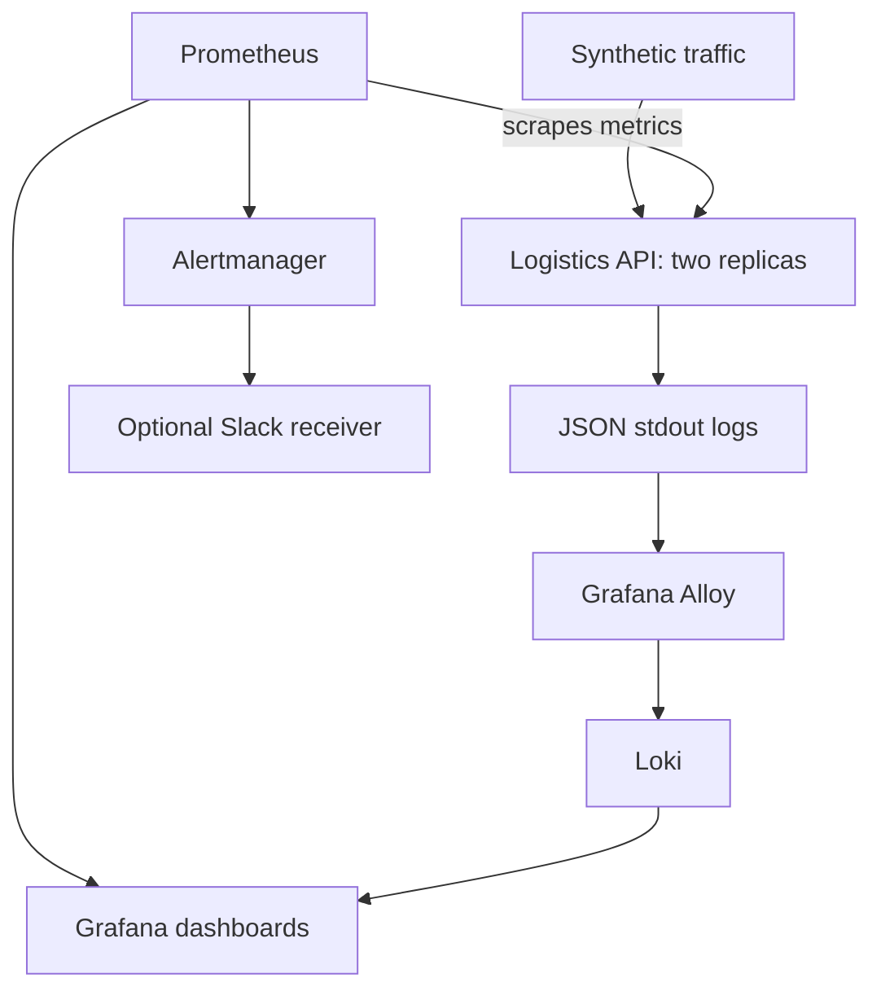

# Real-Time Logistics Observability and Alerting

Independent portfolio lab using synthetic delivery data, informed by logistics operations.
Demonstrates application metrics, structured logs, Grafana dashboards, Prometheus alerts and incident recovery.
It contains no company source code, customer data or claims of production deployment.

## Architecture



## Status

Implementation prepared. Kubernetes deployment, dashboard screenshots, alert runtime verification and
Slack delivery remain pending until executed. See `evidence/README.md`.
The lab uses ephemeral storage and no public ingress. It is not a production platform.

## Run API tests without Docker

Requires Python 3.12 or newer. No third-party Python dependencies.

```bash
python -m unittest discover -s tests -v
python app/server.py
```

Visit `http://localhost:8080/deliveries/demo-1` and `/metrics`.
Simulation endpoints are disabled unless `ENABLE_SIMULATION=true`.
Kubernetes lab manifests enable simulation explicitly. Do not expose this lab publicly.
Metrics use fixed route names, keeping delivery IDs and request IDs out of metric labels.

## Easiest full deployment: GitHub Actions

1. Create a GitHub repository named `03-logistics-observability`.
2. Upload the CONTENTS of this folder to the repository root, including `.github/workflows`.
3. Open Actions and run **Observability lab**, or push a commit.
4. Review the API tests and integration job. Download the evidence artifact.
5. Treat any red workflow as a failed check and inspect its diagnostic artifact.

GitHub runs Docker and Kubernetes on its runner. Your laptop only needs a browser.
The integration job creates and deletes a temporary kind cluster. It provisions no AWS resources.
Runner billing depends on your GitHub plan and repository settings.
A successful workflow proves programmatic checks, not dashboard appearance or Slack delivery.

## Interactive lab for screenshots

Requires Bash (Linux/WSL), Docker, kind, kubectl, Helm 3 and Python.
Plan roughly 4 CPUs and 8 GiB free RAM for the full stack, with sufficient disk for images.
Actual requirements vary by chart version and workload.

```bash
kind create cluster --name observability
kubectl config use-context kind-observability
docker build -t logistics-api:lab .
kind load docker-image logistics-api:lab --name observability
bash scripts/deploy.sh
```

The script installs into the current context. Confirm it is your disposable lab first.
Upstream chart versions are resolved at install time and recorded in `evidence/chart-versions.json`.
For repeatable subsequent runs, set `PROMETHEUS_CHART_VERSION`, `LOKI_CHART_VERSION` and
`ALLOY_CHART_VERSION` to the successful versions recorded there. These configurations need
runtime validation against the selected versions before any production use.

In separate terminals:

```bash
kubectl port-forward -n logistics svc/logistics-api 8080:8080
kubectl port-forward -n monitoring svc/obs-grafana 3000:80
kubectl port-forward -n monitoring svc/obs-kube-prometheus-stack-prometheus 9090:9090
kubectl port-forward -n monitoring svc/loki-gateway 3100:80
```

Get the generated Grafana password locally (do not put it in screenshots):

```bash
kubectl get secret obs-grafana -n monitoring -o jsonpath='{.data.admin-password}' | base64 --decode
```

Sign in at `http://localhost:3000` as `admin`. Open **Logistics API Overview**.
In Explore select Loki and query `{app="logistics-api"} | json`.

```bash
python scripts/traffic.py --seconds 60
python scripts/verify.py metrics
python scripts/verify.py logs
python scripts/traffic.py --mode error --seconds 180
python scripts/verify.py firing
python scripts/traffic.py --seconds 180
python scripts/verify.py resolved
```

See `docs/runbooks.md` for latency and outage tests, and `docs/slack.md` for optional notifications.
Firing/resolved checks query real Prometheus ALERTS series. Resolution alone does not prove
notification delivery. Each workflow checks firing before checking resolution.

## Evidence checklist

- [ ] Successful API test job and security scan
- [ ] Metrics returned from Prometheus
- [ ] Application JSON logs returned from Loki
- [ ] Error, latency and outage alerts fire and resolve
- [ ] Grafana dashboard screenshots with generated traffic
- [ ] Optional firing/resolved Slack notifications
- [ ] Incident notes and installed chart versions
- [ ] Disposable infrastructure deleted

## Cleanup

For the local kind lab only:

```bash
kind delete cluster --name observability
```

Stop local port-forwards with Ctrl+C. The lab stores data inside the disposable cluster.
Export evidence before deleting it. This cleanup does not remove any AWS infrastructure.

## Sources

- https://github.com/prometheus-community/helm-charts/tree/main/charts/kube-prometheus-stack
- https://grafana.com/docs/loki/latest/get-started/
- https://github.com/grafana/alloy/tree/main/operations/helm/charts/alloy

## Limitations and next improvements

This is a single-cluster lab, not an HA monitoring design. It has no durable metrics/log storage,
TLS ingress, external secret manager or notification-delivery test. The Python API uses synthetic
responses, not GPS tracking or a real database. Pin successful chart/image versions and action SHAs
when promoting the lab into a maintained project. Alerts use short demonstration thresholds.
